# Summary

**What AHPPA is.** AHPPA is an adaptive planner portfolio for an indoor drone that flies on a map built from its own depth cameras. It keeps several path planners. Before every plan it measures how much free space surrounds the drone and picks the planner suited to that situation:

* **OPEN** (lots of room): an any-angle planner, Lazy Theta\*, for short, straight paths;
* **MEDIUM**: the stock layered A\*;
* **DENSE** (tight spaces): a clearance-aware A\*;
* **ESCAPE** (the drone is stuck): a recovery mode.

**Why we built it.** Our first stack compared six planners in one Gazebo house, and no planner won everywhere:

* A\* was reliable but produced staircase paths;
* Theta\* was shorter and smoother;
* the sampling planners (PRM, RRT) failed three times in five.

A portfolio promised the best of each.

**What happened, in five stages.**

| Stage | Question | Answer |
|---|---|---|
| 1. Our own world | Does AHPPA beat stock A\* in our house? | Partly. OPEN paths were 5–21 % shorter, but the dispatcher rarely chose OPEN, and DENSE made one path worse. |
| 2. First flights | Does it work with real perception in Gazebo? | After fixing the drone mapping its own propellers, mode choices matched the geometry. Flying OPEN paths for the first time exposed three navigator bugs and a railing crash; all were fixed and re-flown. |
| 3. 44 worlds | Does it generalise beyond our house? | Only after a fix. As deployed, it read the ceiling as an obstacle and almost never switched. With horizontal clearance, paths were 2.8 % shorter and had 59 % fewer waypoints, in every layout type, with no loss of safety. |
| 4. Honest check | Is planner switching itself worth it? | No. Always using Lazy Theta\* beats AHPPA's rule, and no learned selector beat the best single planner. |
| 5. The fix | What should AHPPA become? | **v2:** smooth the A\* path, which gives nearly any-angle length at A\* cost. **v3/v3.1:** *contact memory*, so the drone remembers what it has hit. Against obstacles the map cannot hold, mission completion went from 41 % to 100 % in simulation. In PX4 flights against unseen glass, crashes fell from 95 % to 61 %. |

**Final standing.**

| Version | Path length vs stock A\* (1,320 queries) | Planning time (total) | Missions completed, mapped worlds | Missions completed, unmapped obstacles (simulation) | PX4 glass flights: crashed / reached the goal |
|---|---:|---:|---:|---:|---:|
| Stock layered A\* | 0 % | 707 s | 94.8 % | 41 % | — |
| AHPPA, first deployed (±1.0 m band) | −0.6 % | ≈ stock | — | — | — |
| AHPPA after the band fix | −2.7 % | 1,372 s | 94.1 % | 41 % | — |
| Lazy Theta\* alone | −4.0 % | 2,013 s | 93.0 % | 42 % | — |
| **AHPPA v2** (A\* + smoothing) | **−3.8 %** | **723 s** | **94.8 %** | 42 % | 95 % / 5 % |
| **AHPPA v3** (+ contact memory) | = v2 | = v2 | = v2 | **100 %** | **70 % / 30 %** |
| **AHPPA v3.1** (+ surface fusion) | = v2 | = v2 | = v2 | **100 %** | **51 % / 35 %** |

# 1. Where AHPPA came from

## 1.1 The base system

The project is an autonomous indoor drone that needs no GPS. It runs on:

* **Simulation:** PX4 software-in-the-loop with Gazebo, so the drone flies in a physics simulation with the real autopilot.
* **Sensing:** depth cameras. First a single OakD-Lite camera; later a 360° rig of five cameras.
* **Mapping:** the point clouds are filtered and fused into an OctoMap, a 3D occupancy map with 10 cm voxels.
* **Navigation:** a navigator node explores frontiers (the edges of the known map), plans paths and flies them through PX4's offboard mode.

It was built in phases:

1. **Phase 1:** perception and the first A\* navigation.
2. **Phase 2:** six planners compared, obstacle-triggered replanning, and a 2.5D layered planner. The 2.5D planner flies at fixed altitude layers (1.2, 1.8, 2.4 m and, for the two-floor house, up to 5.4 m) and moves between them.
3. **Phase 3:** frontier exploration.

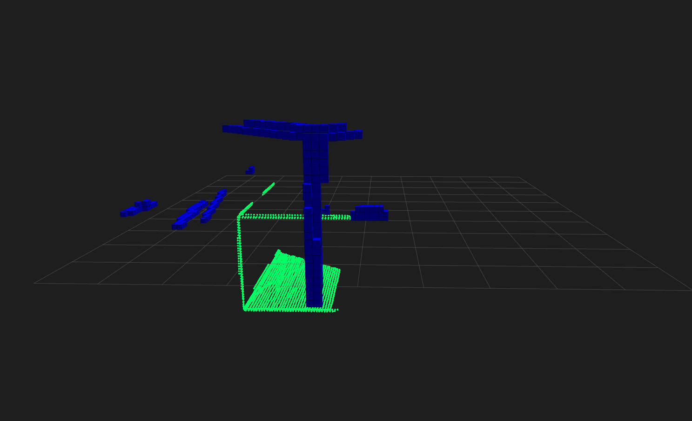{width=55%}

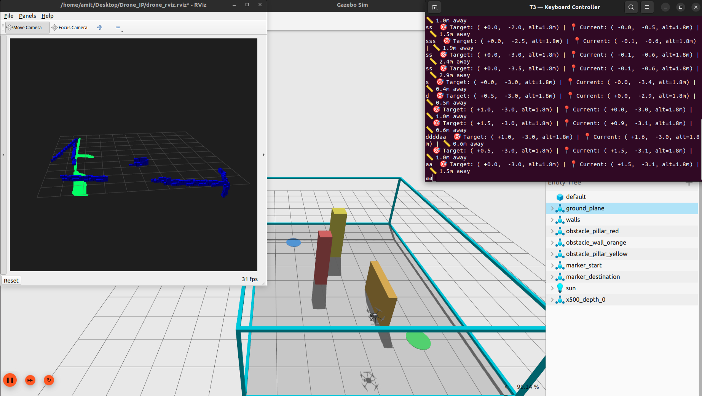{width=70%}

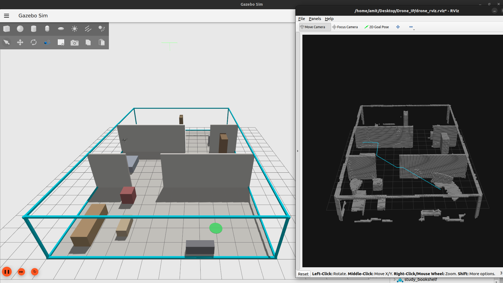{width=85%}

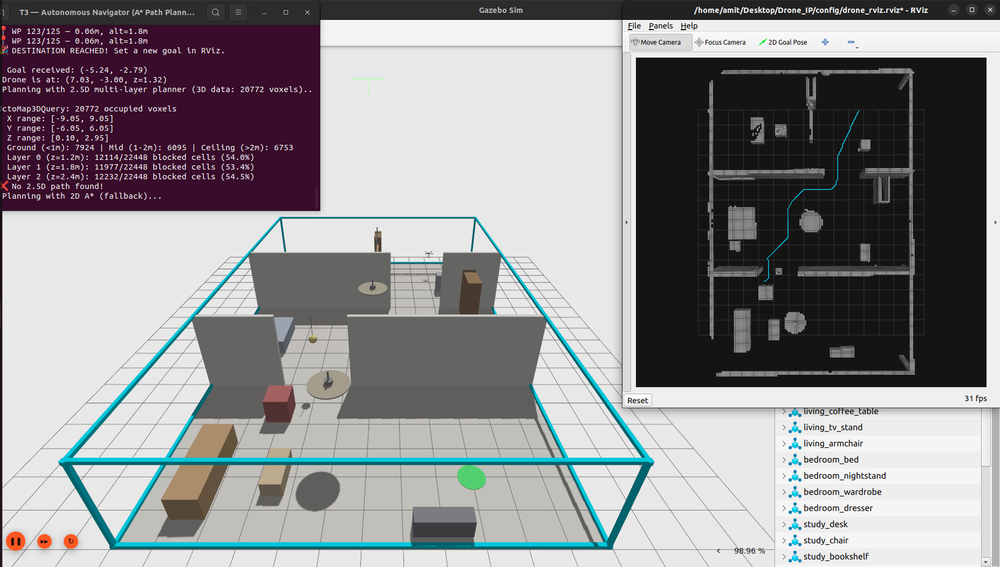{width=80%}

## 1.2 Six planners, no winner

In Phase 2 we ran six planners on the same OctoMap of house_3room over five test routes, including cross-room routes through doors:

* the grid searches A\*, Dijkstra and Bellman-Ford;
* the any-angle grid search Theta\*;
* the sampling planners PRM and RRT.

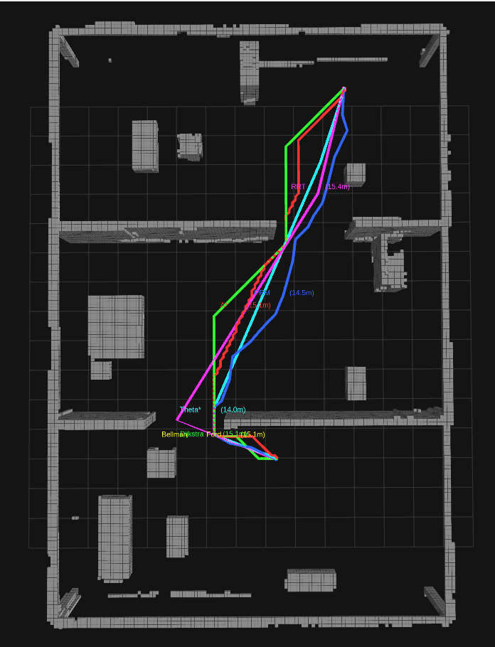{width=70%}

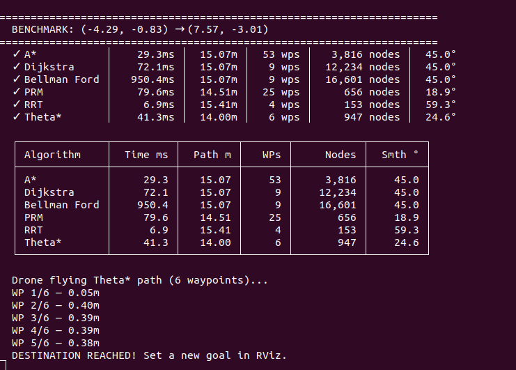{width=70%}

| Planner | Routes solved | Planning time | Nodes explored | Mean path length | Smoothness metric |
|---|---:|---:|---:|---:|---:|
| A\* | 5/5 | 13 ms | 1,826 | 9.90 m | 36° |
| Dijkstra | 5/5 | 44 ms | 8,255 | 9.90 m | 36° |
| Bellman-Ford | 5/5 | 748 ms | 23,533 | 9.90 m | 36° |
| **Theta\*** | 5/5 | 26 ms | 622 | **9.31 m** | **20°** |
| PRM | 2/5 | 68 ms | 655 | — | 16° |
| RRT | 2/5 | 29 ms | 258 | — | 16° |

: Table 1. The six-planner comparison (house_3room, 5 routes). PRM and RRT path lengths are left out because they come only from the two easy routes they solved.

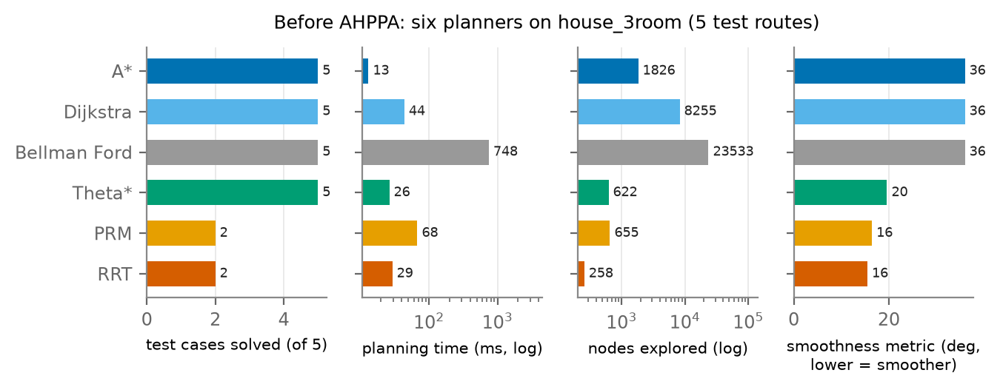{width=100%}

**What this taught us.** No planner wins on every count:

* **A\*** is fast and always succeeds. Its paths, though, are grid staircases with many small turns, which the drone has to smooth out in flight.
* **Theta\*** gives about 6 % shorter, much straighter paths, but costs about twice the planning time.
* **PRM and RRT** are unreliable on indoor maps with narrow doors.
* **None of them** values distance from obstacles, and none has a plan for when the drone gets stuck.

## 1.3 The idea: let the situation choose the planner

AHPPA turns that lesson into a policy. Before each plan it measures the **clearance** $c$: the distance from the drone to the nearest occupied voxel within a vertical band around its altitude. It converts clearance into a **tightness** score, $t = \text{clamp}((1.5 - c)/1.5, 0, 1)$. Tightness picks a mode:

| Mode | When | Planner | Intent |
|---|---|---|---|
| OPEN | clearance > about 1.0 m | Lazy Theta\* (any-angle) | the shortest, straightest path where there is room |
| MEDIUM | in between | stock 2.5D layered A\* | baseline behaviour |
| DENSE | clearance < about 0.5 m | clearance-weighted A\* | give up length for margin in tight spaces |
| ESCAPE | the watchdog trips (moved < 0.3 m in 6 s) | clearance A\* | break out of a stuck state |

: Table 2. AHPPA modes. Hysteresis of ±0.03 on tightness and a minimum dwell of 0.5 s of simulated time stop the mode from chattering.

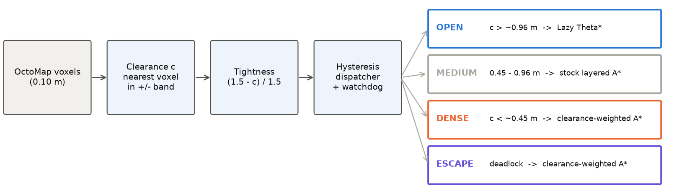{width=100%}

**Design choices worth knowing:**

* **Drop-in replacement.** AHPPA is a subclass of the navigator's planner, so switching it on or off is one environment variable (`AHPPA_PORTFOLIO=1`). That made every A/B comparison in this report a one-line change.
* **The mode outlives the planner object.** The dispatcher lives at module level, because the planner object is rebuilt on every replan. Otherwise the hysteresis would reset each time.
* **Clearance instead of density.** On 25 October the first rule, based on obstacle density, was replaced by clearance, because density thresholds did not carry over from one world to another.

# 2. The Gazebo worlds

We used four Gazebo worlds of our own, plus 41 layouts from a published world collection (Section 5).

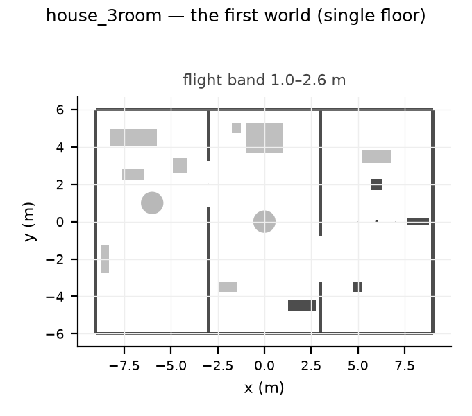{width=75%}

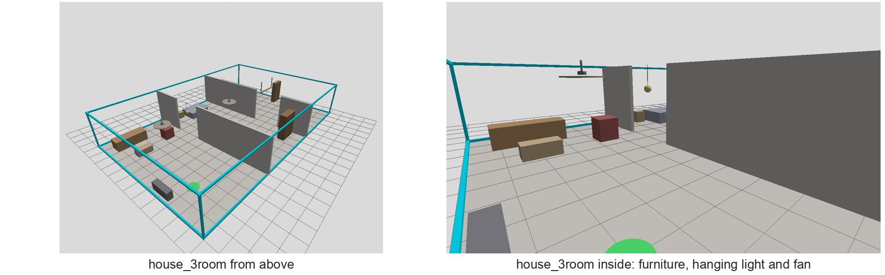{width=100%}

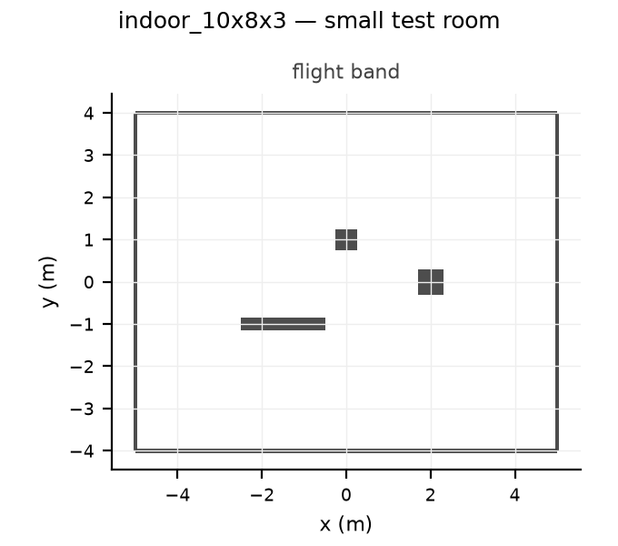{width=60%}

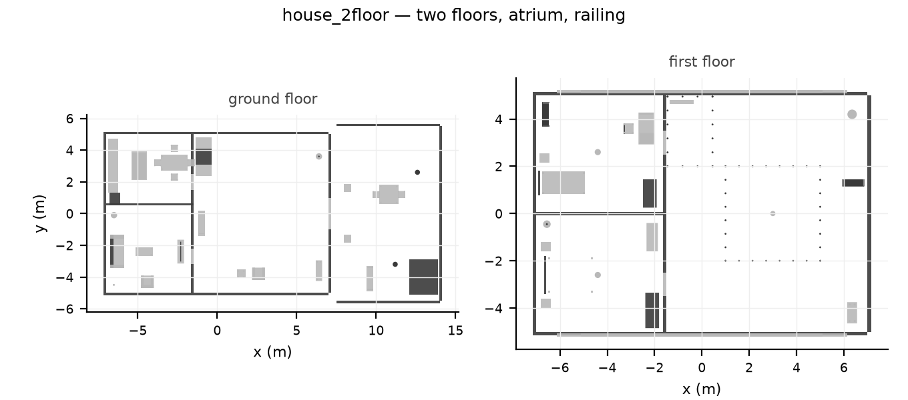{width=100%}

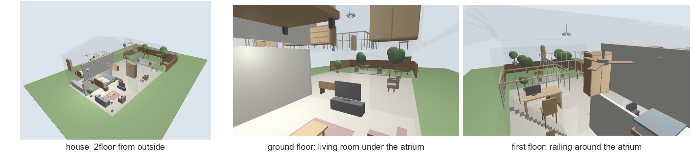{width=100%}

{width=60%}

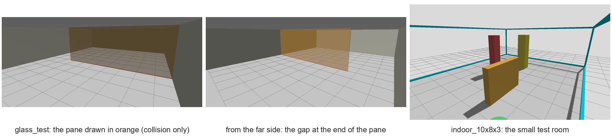{width=100%}

| World | Size | What it tests |
|---|---|---|
| house_3room | 18 × 12 × 3 m, 3 rooms | doorways, furniture, ceiling hazards |
| indoor_10x8x3 | 10 × 8 × 3 m | a simple room with a few blocks |
| house_2floor | two floors, atrium, garden | floor changes, a low ceiling, thin railing posts, outdoor space |
| glass_test | 14 × 10 m room | an obstacle the map can never hold |
| 41 collection layouts | up to 6,300 m² | mazes, offices, warehouses, forests, urban blocks, real floor plans, targeted scenarios |

: Table 3. Worlds used.

# 3. How we tested

This section explains every test in the report: what it measures, how big it is, how each metric is defined, which statistical test gives each p-value, and how each confidence interval was computed. Later sections refer back to it.

## 3.1 The tests at a glance

| # | Test | Where | Planners compared | Sample size | Main metrics | Statistics |
|---|---|---|---|---|---|---|
| T1 | Six-planner comparison | house_3room OctoMap | A\*, Dijkstra, Bellman-Ford, Theta\*, PRM, RRT | 5 routes, 1 run each | solved, time, length, waypoints, nodes, smoothness | descriptive only |
| T2 | Single-house benchmark | house_2floor, fully known map | stock A\*, AHPPA | 18 queries, time = median of 3 runs | solved, length, time, waypoints, heading change, min. clearance | descriptive (per-query) |
| T3 | Gazebo flight tests | house_2floor, PX4 SITL | AHPPA (live) | 1 crash flight (5 goals) + 1 re-fly (6 goals) | goal reached, altitude near posts, tilt, closest approach | pass/fail against criteria set before the re-fly |
| T4 | 44-layout static benchmark | 44 layouts, fully known maps | stock A\*, AHPPA (±1.0 m), AHPPA-h (±0.3 m) | 1,320 queries × 3 planners = 3,960 plans | solved, length change, waypoints, heading change, min. clearance, time, mode | paired Wilcoxon signed-rank; 95 % bootstrap CI (4,000 resamples of queries) |
| T5 | Baselines and oracle | same 1,320 queries | members alone, random, AHPPA, oracle | 2,640 extra plans | length, time, clearance, share of the oracle's saving captured | paired Wilcoxon; 95 % bootstrap CI over layouts |
| T6 | Learned selector | same queries | depth-2 decision tree | leave-one-family-out over 21 families, 30 weightings | combined cost J | gain over the best fixed planner (held-out) |
| T7 | Parallel race | same queries | stock A\*, Lazy Theta\*, race at 7 wait factors | 1,320 queries × 3 rotated repeats = 11,880 runs | length, total time, 95th-percentile time | per-query medians; 95 % bootstrap CI over layouts (3,000 resamples); Wilcoxon |
| T8 | v2 static benchmark | same queries | stock, A\* + smoothing, Lazy Theta\* variants, AHPPA | 1,320 queries per planner | length change, total and tail time, clearance | paired comparison on identical queries |
| T9 | Full-mission simulator | 44 layouts, map built in flight | stock, A\* + smoothing, Lazy Theta\*, AHPPA, v2 | 440 missions × 5 = 2,200 | completed / collision / time-out, mission time, watchdog trips | Wilcoxon on paired mission times; 95 % bootstrap CI over worlds (2,000 resamples) |
| T10 | Bump-model simulator | 6 unmapped-obstacle scenarios + 1 control | stock, A\* + smoothing, Lazy Theta\*, AHPPA, v2, v3, v3.1 | 30 missions × 7 scenarios = 210 per planner | completed, contacts per mission, time, P(survive) | paired Wilcoxon over missions |
| T11 | PX4 glass flights | glass_test, PX4 SITL + Gazebo | v2, v3, v3.1 | 110 flights in 4 batches (103 valid) | reached / crashed / gave up, contacts, first-contact survival, time | Fisher's exact test (two-sided) on counts; Mann-Whitney U (one-sided) on contact counts |

: Table 4. Every test in this report.

## 3.2 How each metric is defined

| Metric | Definition |
|---|---|
| Solved (static tests) | a path is returned that ends within 0.6 m of the goal, within 30 s |
| Path length | sum of the 3D segment lengths of the returned path |
| Length change | (planner length / stock A\* length) − 1, per query, on queries both solved |
| Waypoints | number of points in the returned path (fewer = smoother) |
| Heading change | sum of the turning angles between consecutive horizontal segments |
| Minimum clearance | the closest the path comes to an occupied voxel centre, sampled every 0.05 m (capped at 2 m) |
| Planning time | wall-clock time of the plan call on the VM |
| Shorter / longer | a query counts as shorter or longer only if the difference exceeds 1 % |
| Captured share | AHPPA's saving divided by the oracle's saving, both relative to stock A\* |
| Mission completed | the drone gets within 0.5 m of the goal; failures are no path, a collision (drone centre within 0.15 m of a true obstacle) or the time limit (60 s + 6 × straight distance / speed) |
| Watchdog trip | moved less than 0.3 m in a 6 s window |
| Contact (simulation) | a step into an unmapped obstacle; the drone is thrown back 0.5 m |
| P(survive) | reach × (1 − p)^contacts^ with p = 0.48 (also reported at p = 0.2) |
| Contact (PX4) | tilt ≥ 10° after at least 1 s below 5° while airborne, or the navigator's own impact detection, whichever counts more; every crash counts as at least one contact |
| Crash (PX4) | tilt ≥ 60° for 0.25 s; the navigator then force-disarms |
| Reached (PX4) | the navigator reports the goal reached (within 0.3 m of the end of the path, and within 0.3 m vertically) |
| Gave up (PX4) | the navigator found no path from where it hovered and dropped the goal |
| Survived first contact | the flight did not crash on its first contact |

: Table 5. Metric definitions.

## 3.3 Statistical methods

* **Paired design.** In every static and simulated test, all planners solve **the same** queries or missions: the same map, start, goal and sensing. So query difficulty cancels out, and differences come only from the planner. Queries are seeded from the layout name, so they are identical in every run and every experiment.
* **Wilcoxon signed-rank test** for paired differences (path length, mission time, contacts per mission). It does not assume the differences are normally distributed. It is used in T4, T5, T7, T9 and T10.
* **Bootstrap 95 % confidence intervals.** We resample, recompute the mean change, and take the middle 95 % of the results:
  * **T4:** 4,000 resamples of queries.
  * **T5 and T7:** 3,000 resamples of whole layouts, because the 30 queries within one layout are not independent.
  * **T9:** 2,000 resamples of whole worlds.
* **Fisher's exact test (two-sided)** for the PX4 flight counts: crashed, reached and gave up. It is exact for small samples and needs no large-sample approximation.
* **Mann-Whitney U test (one-sided)** for pane-contact counts in the relaxed flights. The groups are different flights, so the test is unpaired. It is one-sided because fusion was designed to reduce re-contacts.
* **Significance.** We call a result significant at p < 0.05. Several comparisons are reported without correcting for multiple tests, so p-values between 0.01 and 0.05 should be read as suggestive.
* **Timing noise.** Repeated runs of the same plan on the VM differed by 0.85–3.9 × (10th–90th percentile). That is why T7 used three rotated repeats with per-query medians. Path lengths are deterministic and exact.

## 3.4 Setup of each test

**T4–T8: static benchmarks.**

* **Maps.** Each world's box and cylinder collisions were voxelised as surfaces at 0.10 m, the flight OctoMap resolution. Floors below 0.15 m were dropped, as in flight.
* **Queries.** 30 per layout at 1.8 m, both ends on free cells of the planner's own inflated grid, 4–25 m apart, in the same connected region.
* **Planner settings.** Identical to the navigator's: 0.40 m safety margin, 8 altitude layers (1.2–5.4 m), unknown-cell penalty 50, a 30 s time limit per call.
* **Ceiling sensitivity.** Four indoor layouts were re-run with the ceiling raised by 0.1 and 0.2 m.

**T9: mission simulator.**

* **Map:** starts empty. Every 0.2 s a 5 m sensor reveals obstacles: 720 rays on the drone's own layer, with walls blocking the rays, plus everything in range on the layers above and below.
* **Motion:** the drone flies at 1 m/s, in 0.1 s steps.
* **Replanning:** checked every 0.2 s. The drone hovers while it plans, so planning time counts in mission time.
* **Watchdog:** the real AHPPA watchdog code.
* **Missions:** 10 per layout, on the same 44 layouts.

**T10: bump simulator.** Same machinery as T9, plus unmapped "ghost" obstacles:

* glass is never sensed;
* posts and netting are sensed with probability 0.02 per sweep within 1–1.5 m.

A contact throws the drone back 0.5 m and costs 1 s; v3 and v3.1 instead hold for 5 s and replan in ESCAPE. These values were measured in PX4: bounce 0.38–1.06 m, and recovery 3.7–10 s with a median of about 5.5 s. v3 and v3.1 call the navigator's own memory code. There are 30 missions per scenario with random start and goal regions, and every planner flies the same missions with the same sensing luck.

**T11: PX4 flights.**

* **Stack:** PX4 SITL with an x500 drone carrying a 360° rig of five depth cameras, ROS 2 Humble, OctoMap at 0.10 m, and the full navigator with live perception.
* **World and goals:** glass_test, with goals (8, 0) or (8, 2) at 1.8 m.
* **Ordering:** flights interleaved by variant, the order rotated every round, and the goal alternated.
* **Batches:**

  | Batch | Variants | Flights | Wall-clock limit | Notes |
  |---|---|---:|---:|---|
  | B20 | v2, v3 | 20 | 240 s | old script |
  | B30 | v2, v3, v3.1 | 30 | 240 s | old script |
  | B40 | v3, v3.1 | 20 | 360 s | fixed script, battery failsafe off |
  | B50 | v3, v3.1 | 40 | 360 s | fixed script, battery failsafe off |

* **Exclusions:** 7 flights in B20/B30 were landed by the old script while relaxing memory. Their outcome is unknown, so they are excluded.
* **Data:** every flight's pose log (5–10 Hz), navigator log, planner CSV and PX4 log were kept and analysed with one script (`px4_analysis.py`).

## 3.5 Hardware and software

* **VM:** Ubuntu 22.04 in UTM on a Mac (4 virtual CPUs, arm64, 7.7 GB).
* **Software:** ROS 2 Humble, PX4 SITL, Gazebo Harmonic (gz sim 8.14), Python 3.10 with numpy 2.2.
* **Flight analysis:** run on the Mac (Python 3.14, scipy), because scipy is broken on the VM.
* **Timing caveat:** up to three benchmark processes ran in parallel on the shared VM. Compare time ratios between planners on the same query, not absolute times.
* **Simulation speed:** Gazebo ran slower than real time, at about 30–60 % depending on the GUI.

# 4. Stage 1 — AHPPA in our own world

## 4.1 The first benchmark: house_2floor, 18 queries

**Method.**

* Every box in house_2floor was voxelised at 0.10 m, giving a fully known map of 176,016 voxels.
* Stock A\* and AHPPA planned the same 18 start/goal pairs: open space, doorways, clutter, multi-room routes and two-floor routes.
* The safety margin was 0.40 m, with 8 altitude layers from 1.2 to 5.4 m.

| Metric | Stock A\* | AHPPA | Change |
|---|---:|---:|---:|
| Queries solved | 14/18 | 14/18 | same |
| Total path length (14 solved) | 118.4 m | 118.0 m | −0.4 % |
| Median planning time | 17.6 ms | 26.4 ms | +50 % |
| Total waypoints | 1,016 | 852 | −16 % |
| Total heading change | 10,620° | 9,341° | −12 % |
| Mode mix | — | OPEN 3, MEDIUM 12, DENSE 3 | |

: Table 6. Single-house benchmark. The four failures were the same for both planners and come from the map: furniture closes one bedroom door at the 0.40 m margin.

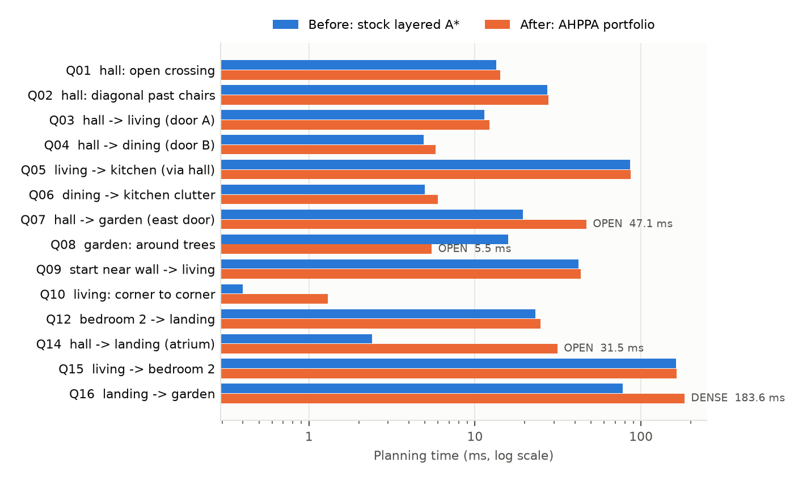{width=90%}

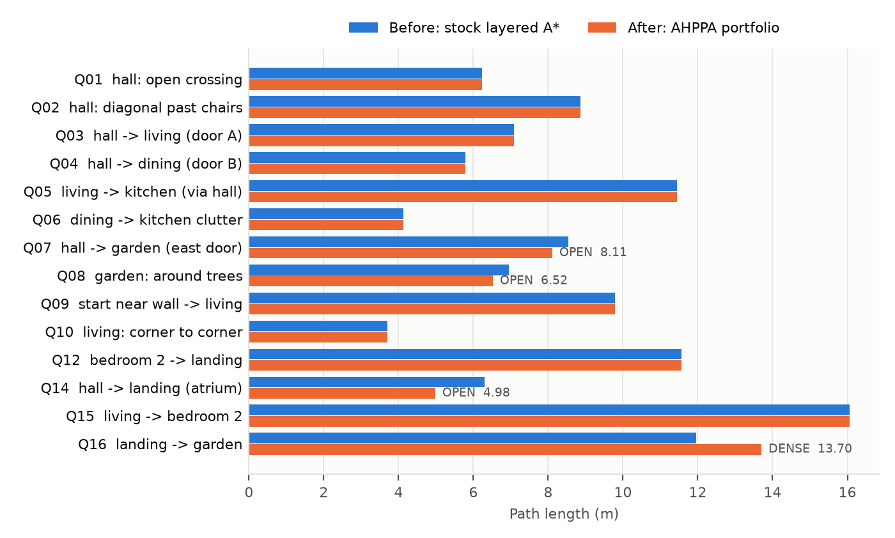{width=90%}

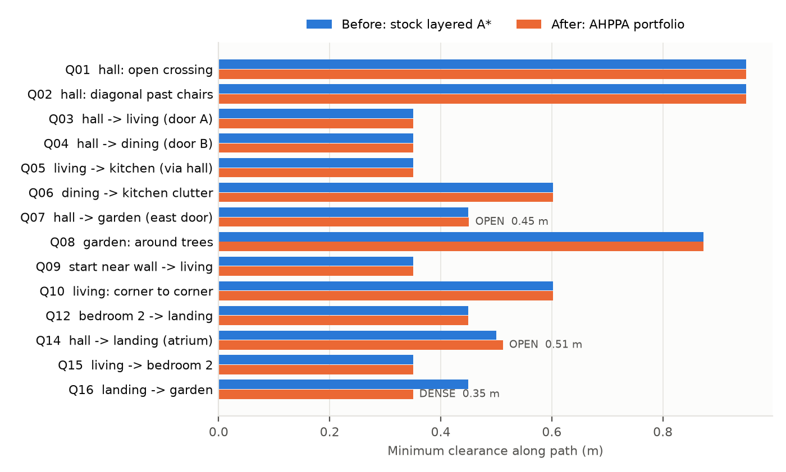{width=90%}

**What we learned.**

* **OPEN worked.** On the three open-space queries, its paths were 5–21 % shorter, including a 21 % shorter climb through the atrium. Clearance stayed the same, with 2–3 waypoints instead of 49–76.
* **DENSE backfired once.** A two-floor descent came out 15 % longer and 0.10 m closer to obstacles. DENSE's distance map is 2D per layer and ignores floor slabs during a descent.
* **OPEN was rare.** Most of the ground floor read as MEDIUM, because the clearance reading included the ceiling 1.0 m above the flight altitude. Only the atrium and the garden read as open. This turned out to be the key bug (Section 5.3).

## 4.2 The first flights in Gazebo

The first flights in house_2floor used the 360° camera rig and the live OctoMap.

* **The drone mapped its own propellers** about 0.28 m above itself. Clearance read 0.15–0.36 m everywhere, so AHPPA chose DENSE in an open hall and replanned three times for nothing.
* **The fix:** a 0.5 m self-filter in the point-cloud merger.
* **After the fix,** readings matched the geometry (2.14 m under the atrium, 0.51 m beside a wall), and the deadlock watchdog sent the planner into ESCAPE for the first time in flight.

## 4.3 Flight test with horizontal clearance (17 November)

After the ceiling problem was found (Section 5.3), the clearance band was changed to ±0.3 m and flown the same day. AHPPA now chose OPEN under the 2.8 m ceiling and flew straight any-angle paths indoors for the first time.

Using OPEN for real exposed problems that had been hidden:

1. **Oscillation.** Lazy Theta\* returns only a start and an end point. The navigator's pure-pursuit follower then swung back and forth between them for 115 s. *Fix:* densify every path to one point per 0.1 m.
2. **Altitude.** A goal straight above the drone counted as reached at once, and hovering always fell back to 1.8 m. *Fix:* a 3D reach check, and holding the altitude of the last goal.
3. **Railing crash.** On the fifth goal the drone flew into the atrium railing at 3.6 m. The 5 cm posts had most likely dropped out of the map, and the path crossed the railing's height band before climbing. The drone flipped, and nothing reacted for 45 s.

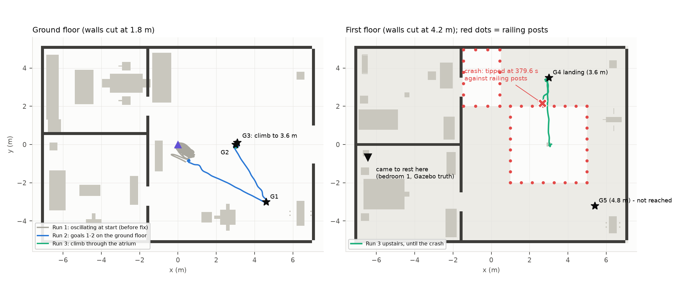{width=100%}

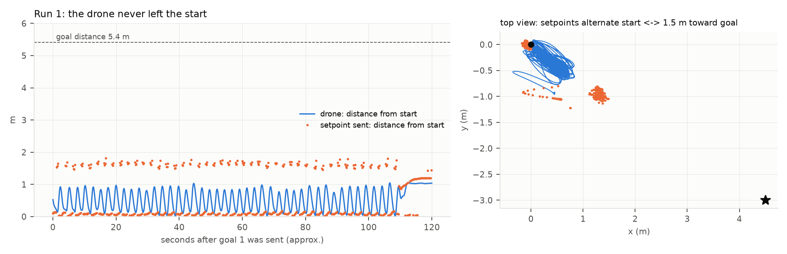{width=90%}

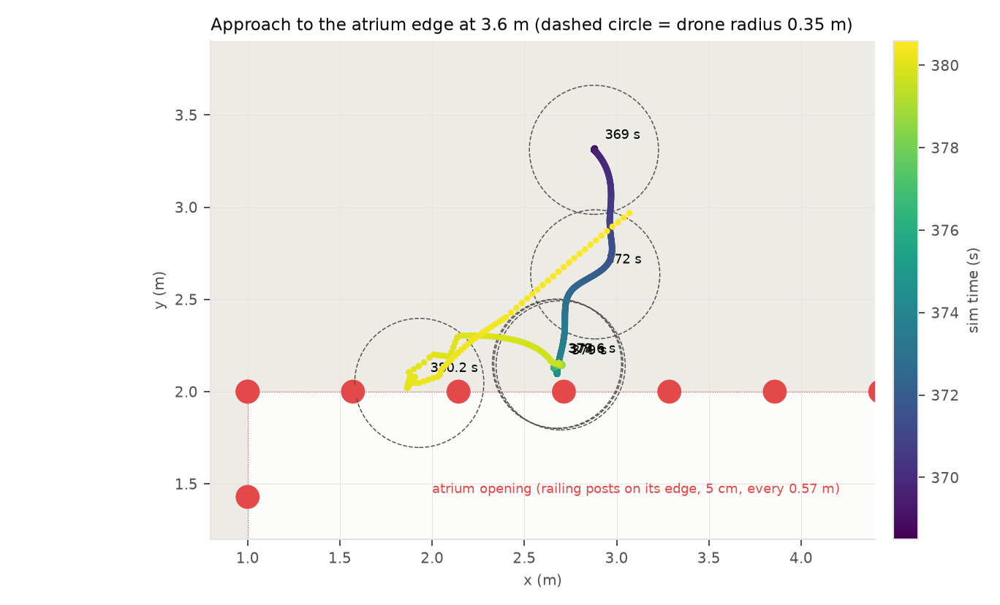{width=60%}

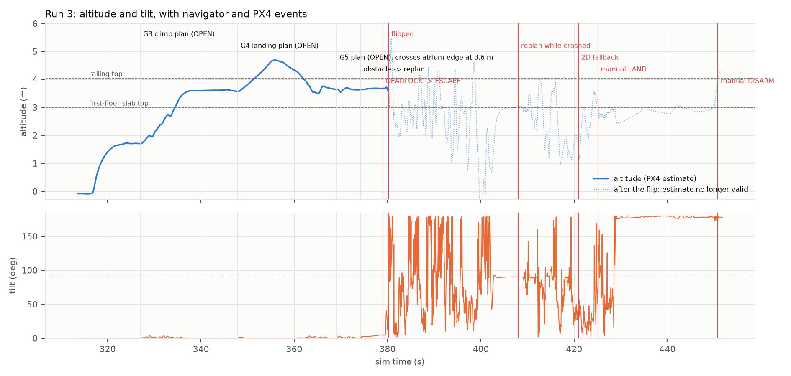{width=100%}

**Corrective actions:**

| # | Fix | Status |
|---|---|---|
| C1 | Densify paths before following them | flight-verified |
| C2 | 3D reach check and altitude hold | flight-verified |
| C3 | Change floors vertically in a clear column (climb first, descend last), then fly level | flight-verified |
| C4 | Crash response: tilt > 60° for 0.25 s forces a disarm | unit-tested; later triggered in every glass crash |
| C5 | No 2D fallback above the ground floor | unit-tested |
| C6 | Occupancy memory: voxels seen twice stay for 60 s | unit-tested |
| C8 | "Reached" anywhere in the last 0.3 m of a path | unit-tested |

: Table 7. Changes made after the 17 November flight test.

**Re-fly.** The same six goals were flown again: all were reached, including the crash goal at 4.85 m. The drone stayed at least 4.47 m high whenever it was near a post, and the maximum tilt was 4.5°.

# 5. Stage 2 — 44 worlds

## 5.1 Why more worlds

One house cannot show whether a planner rule generalises. We took 41 layouts from a published collection of benchmark worlds:

* mazes, offices, warehouse aisles, forests, urban blocks;
* two real floor plans;
* ten targeted scenario tests: loops, narrow passages, dead-end combs, nested pockets, an open hall, clutter fields, a zig-zag.

We added our own three houses, for 44 layouts in all.

**Turning ground-robot worlds into drone worlds.** The collection was built for ground robots, whose walls are 2 m tall, and a drone would simply fly over them. So every wall 1.9 m or taller was raised to 2.8 m and a ceiling slab was added. Low obstacles such as 1.2 m tables kept their height, so the drone may fly over them. Forest and urban layouts kept their real heights and got no ceiling.

**Queries.**

* 30 start/goal pairs per layout at the 1.8 m flight layer, each 4–25 m apart and in the same connected region.
* The random seed comes from the layout name, so every planner and every later experiment got exactly the same 1,320 queries.

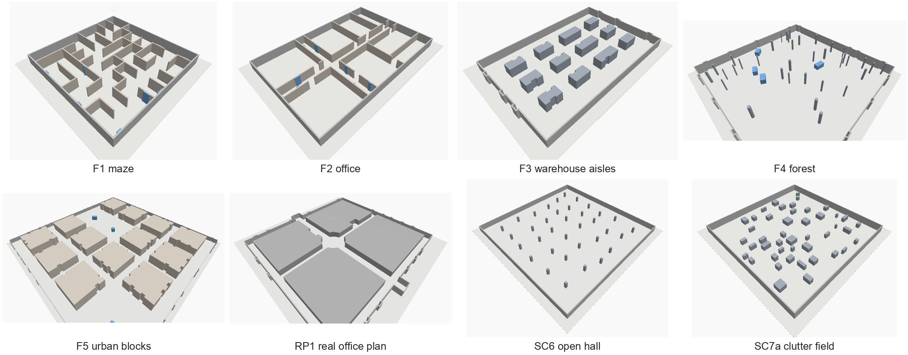{width=100%}

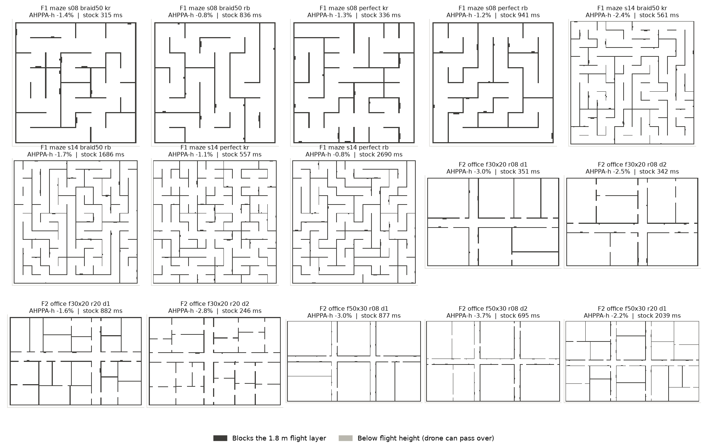{width=100%}

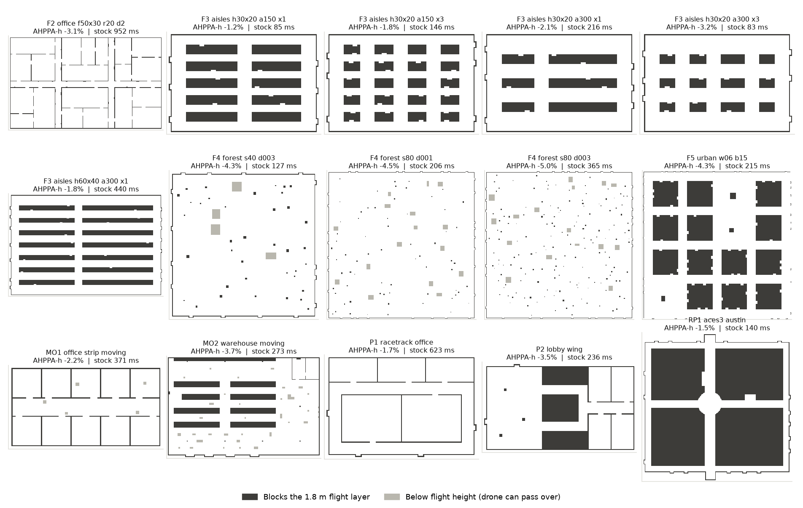{width=100%}

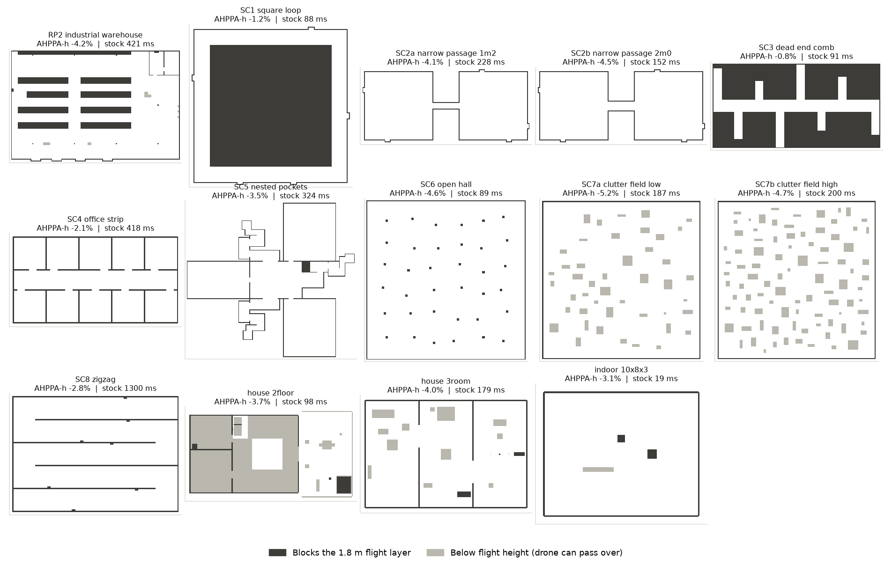{width=100%}

## 5.2 Headline result

| Metric (1,320 queries) | Stock A\* | AHPPA as deployed (±1.0 m) | AHPPA-h (±0.3 m) |
|---|---:|---:|---:|
| Queries solved | 1,320 | 1,320 | 1,318 |
| Mode mix | A\* 100 % | OPEN 12 %, MEDIUM 88 % | OPEN 67 %, MEDIUM 33 % |
| Mean length change (95 % CI) | — | −0.6 % (−0.7 to −0.5) | **−2.8 % (−2.9 to −2.6)** |
| Shorter / same / longer | — | 149 / 1,169 / 2 | **842 / 476 / 0** |
| Mean waypoints per path | 203 | 189 | **84** |
| Mean heading change per path | 1,275° | 1,148° | **532°** |
| Tightest path (min clearance) | 0.35 m | 0.35 m | 0.35 m |
| Planning time, median / 95th pct | 298 ms / 3.0 s | 298 ms / 3.1 s | 416 ms / 6.3 s |

: Table 8. Results over all 44 layouts. Wilcoxon signed-rank test p < 0.001 for both AHPPA variants.

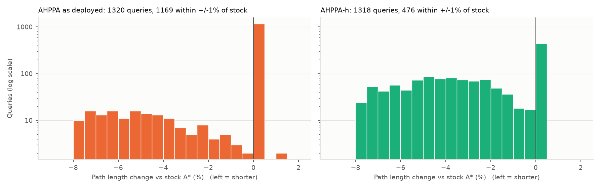{width=100%}

**Why 7.6 % is the ceiling.** An 8-direction grid path can only move straight or at 45°. It is at most 8.2 % longer than the straight line, so an any-angle path can save at most 7.6 %. Several queries hit exactly that bound.

## 5.3 The ceiling bug

In the 37 indoor layouts, the deployed AHPPA chose MEDIUM on 1,109 of 1,110 queries. The reason:

* Clearance counted every voxel within ±1.0 m of the flight altitude. At 1.8 m, that band reaches up to 2.8 m, which is exactly where the ceiling is.
* So the reading was 0.95 m almost everywhere, 5 mm under the OPEN threshold.
* Raising the ceiling by 10 cm in four layouts flipped the deployed version to OPEN on 76 of 120 queries.

The mode was being decided by the ceiling and by voxel rounding, not by the walls around the drone.

**The fix** (commit a7abc33) measures clearance in the planner's own ±0.3 m collision band. That makes the reading mean what it was designed to mean: room to manoeuvre sideways.

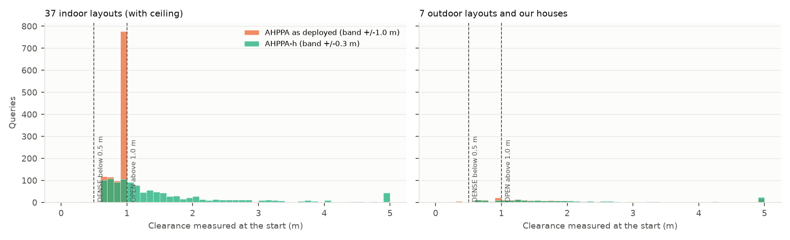{width=100%}

## 5.4 By layout type

| Layout type | Layouts | AHPPA-h modes | AHPPA-h length change (95 % CI) |
|---|---:|---|---:|
| Mazes | 8 | OPEN 41 %, MEDIUM 59 % | −1.3 % (−1.6 to −1.1) |
| Offices | 11 | OPEN 68 % | −2.6 % (−2.8 to −2.4) |
| Warehouses | 8 | OPEN 63 % | −2.5 % (−2.8 to −2.2) |
| Scenario tests | 10 | OPEN 78 % | −3.3 % (−3.6 to −3.1) |
| Outdoor | 4 | OPEN 92 % | −4.5 % (−4.9 to −4.1) |
| Our houses | 3 | OPEN 74 % | −3.6 % (−4.1 to −3.1) |

: Table 9. Every confidence interval lies entirely below zero: the gain is not driven by a few layouts.

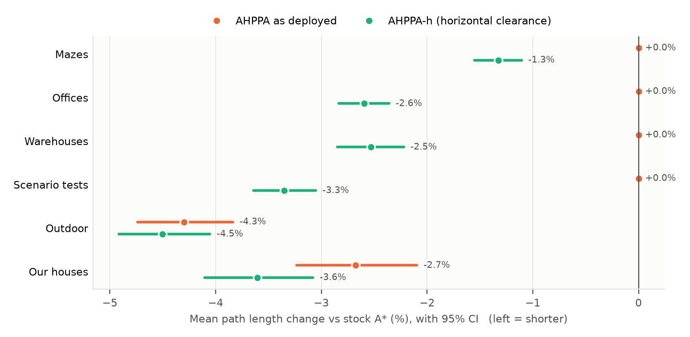{width=90%}

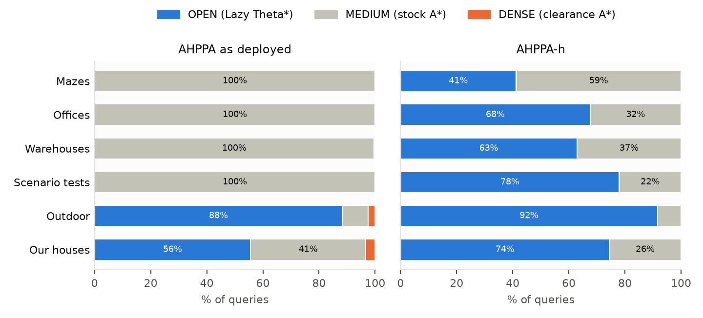{width=100%}

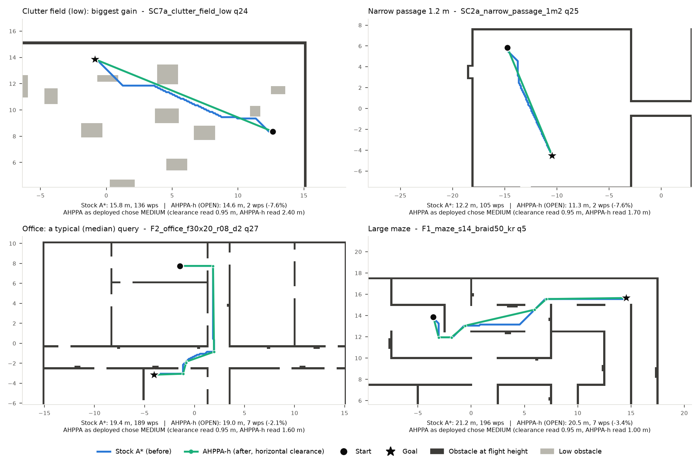{width=100%}

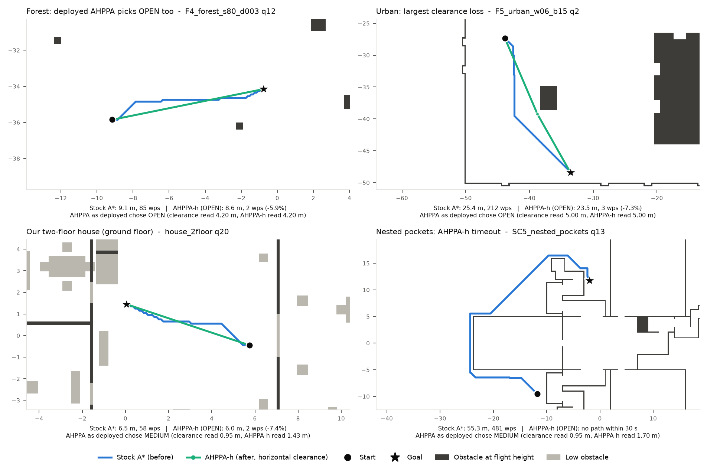{width=100%}

**Smoothness and safety.**

* AHPPA-h paths have 59 % fewer waypoints and 58 % less total turning.
* No variant flew closer to obstacles than stock A\* does at its tightest (0.35 m).
* The clearance losses happen where Lazy Theta\* cuts diagonally across open space and passes an obstacle at about 1 m, where A\* happened to stay 2 m away.

**Planning time.** Lazy Theta\* is 2.5–3 × faster than A\* in open clutter fields. It is slower in mazes and offices, where long routes wrap around many corners. Its worst case was 37.6 s, in a 14 × 14 maze.

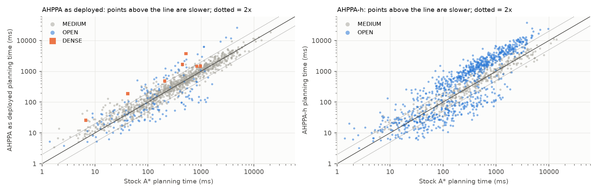{width=100%}

**Which layouts gain most.** The more open the layout, the bigger the gain (r = −0.75 against median free-space clearance). The more winding the routes, the smaller the gain (Spearman ρ = +0.71).

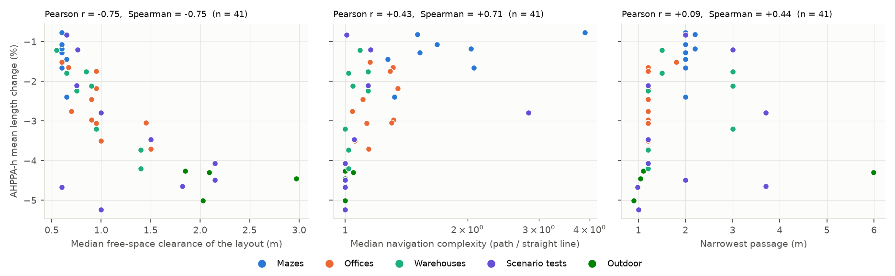{width=100%}

# 6. Stage 3 — is planner switching worth it?

A portfolio only earns its place if it beats its **best member used alone**. So each member was run alone on all 1,320 queries, and compared with two reference selectors:

* a **random pick** among the members, as a floor;
* a **hindsight oracle**, which picks the best member for each query after the fact, as a ceiling.

| Selector | Length vs stock | Median time | Total time | Mean min. clearance |
|---|---:|---:|---:|---:|
| Stock A\* | 0.00 % | 298 ms | 985 s | 0.59 m |
| **Lazy Theta\* alone** | **−4.01 %** | 353 ms | 1,848 s | 0.60 m |
| Clearance A\* alone | +4.40 % | 296 ms | 855 s | 0.75 m |
| Random pick | +0.13 % | 343 ms | — | 0.64 m |
| AHPPA | −2.77 % | 416 ms | 1,960 s | 0.59 m |
| Oracle (hindsight) | −4.01 % | 353 ms | — | 0.60 m |

: Table 10. Baselines over 1,318 queries.

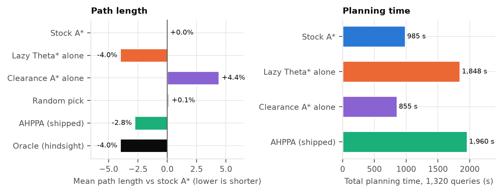{width=100%}

**Findings.**

* **The oracle is Lazy Theta\*.** It was the best member on 1,312 of 1,318 queries.
* **AHPPA captures only 64 % of the possible saving.** Its MEDIUM mode sends 436 queries to the planner that is never best.
* **Selection itself does not pay.** We also scored length, planning time and clearance together. A learned selector, trained on 20 layout families and tested on the 21st, never beat the best single planner on any weighting.
* **Racing is a trade-off, not a free win.** Running Lazy Theta\* and A\* in parallel and taking the first answer is a dial between the two planners. It never beats stock A\* on both length and time.

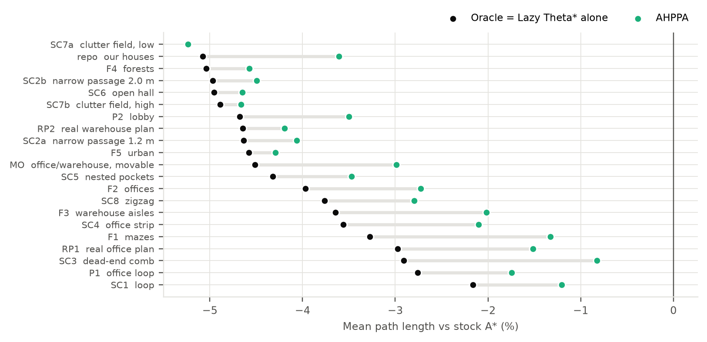{width=90%}

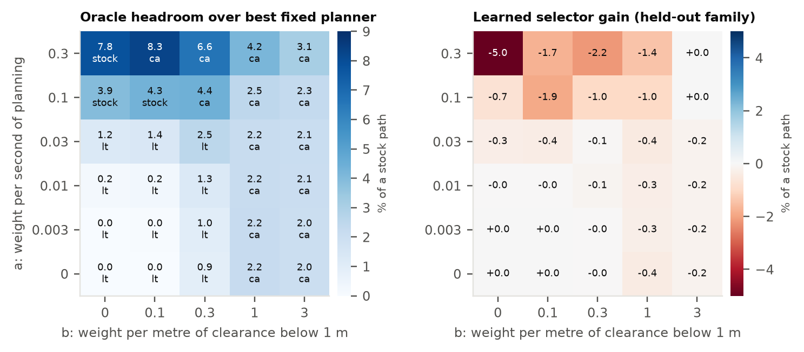{width=100%}

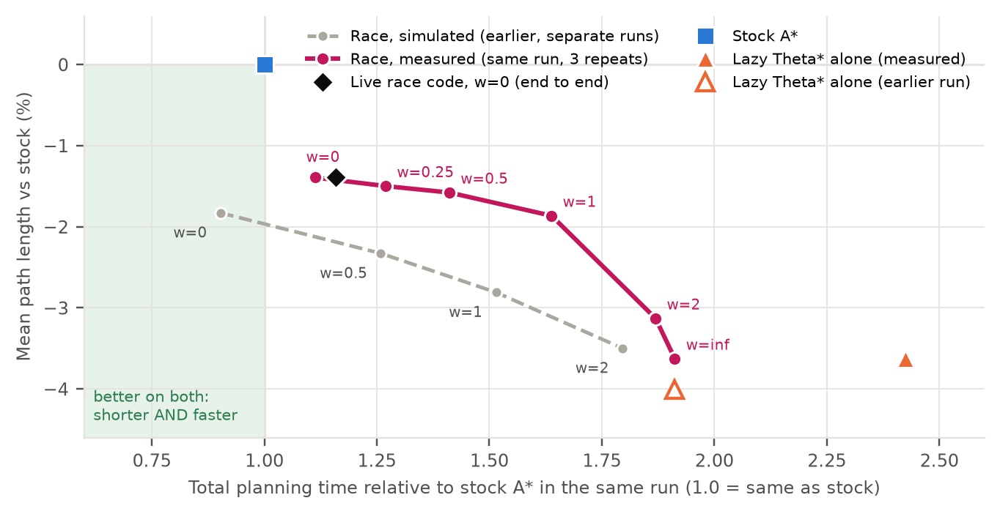{width=70%}

**The robustness fix that did hold up.** AHPPA's only two failures were time-outs of Lazy Theta\* in the nested-pockets layout. A 5 s time budget per member, with a fall-back to A\*, fixed them: that layout went from 28 to 30 of 30 solved.

**Conclusion of Stage 3.** On static, single queries, choosing a planner per query is a dead end. AHPPA had to find a different job.

# 7. Stage 4 — three fixes

## 7.1 Fix 1: the middle mode (AHPPA v2)

Lazy Theta\* wins on length, but it is slow. Most of its saving comes from straightening the grid staircase, so we straightened the A\* path instead: a line-of-sight shortcut pass over the A\* output.

| Planner (1,320 queries) | Length vs stock | Total planning time |
|---|---:|---:|
| Stock A\* | 0.00 % | 707 s |
| AHPPA after the band fix | −2.65 % | 1,372 s |
| AHPPA, MEDIUM → Lazy Theta\* | −3.79 % | 1,886 s |
| Lazy Theta\* everywhere | −4.01 % | 2,013 s |
| **AHPPA v2 (A\* + smoothing)** | **−3.80 %** | **723 s** |

: Table 11. v2 gets within 0.2 % of Lazy Theta\*'s length, at 2 % extra planning time.

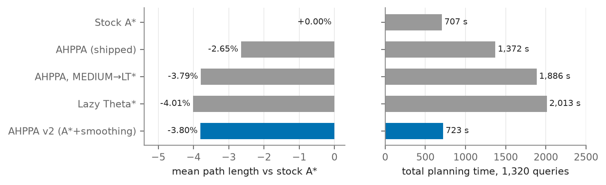{width=100%}

## 7.2 Fix 2: evaluate whole missions

Single plans do not exercise replanning, the watchdog or ESCAPE. We built a mission simulator to test those:

* the drone senses the world as it flies, so the map grows incrementally;
* it replans on new obstacles and is scored on whole missions.

Five planners flew 440 missions each, 2,200 in all.

| Planner | Completed | Collisions | Watchdog trips | Mission time vs stock |
|---|---:|---:|---:|---:|
| Stock A\* | 94.8 % | 0 | 0 | — |
| A\* + smoothing | 94.8 % | 0 | 0 | +0.9 % (n.s.) |
| Lazy Theta\* | 93.0 % | 0 | 0 | +12.7 % (95 % CI +7.7 to +17.1) |
| AHPPA (after band fix) | 94.1 % | 0 | 0 | +2.8 % (n.s.) |
| **AHPPA v2** | **94.8 %** | 0 | 0 | +0.9 % (n.s.) |

: Table 12. 2,200 simulated missions. The failures are time-outs in mazes and long winding layouts, the same for all planners. n.s. = not significant.

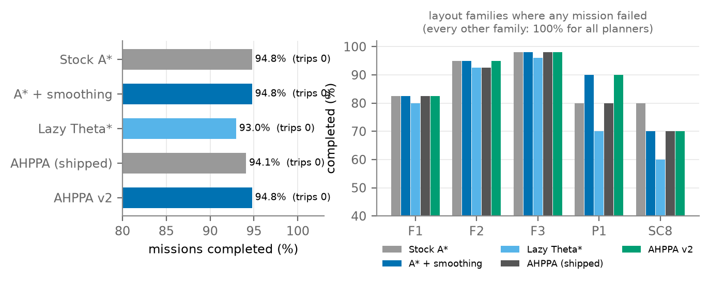{width=100%}

**The key finding: the watchdog never fired.** On a map that eventually sees every obstacle, nothing gets stuck. So the deadlocks AHPPA's ESCAPE mode was built for must come from obstacles the map **never** holds: glass, thin posts that drop out, netting. That is exactly what caused the railing crash in Section 4.3.

## 7.3 Fix 3: contact memory (v3) and surface fusion (v3.1)

**Contact memory (v3).**

* When the drone is knocked back, tilted, or stopped by something its map says is free, the planner writes a **virtual barrier**. The barrier is 4 m wide and lies across the direction of travel, just ahead of the contact.
* The next plan is made in ESCAPE mode.
* Barriers live only in the planner's temporary grids, never in the sensed map.
* If the barriers seal every route, they are relaxed step by step: bar → contact points (dots) → none.

**Surface fusion (v3.1).** In flight, the drone hit the glass at up to 33° from square-on. A barrier drawn across such a heading is tilted, so the next route slid past its tip into the same pane.

* v3.1 groups contacts that lie on one straight line and draws a single barrier along that line.
* Its relaxation ladder gains a 'hull' level: the measured span plus 0.5 m.

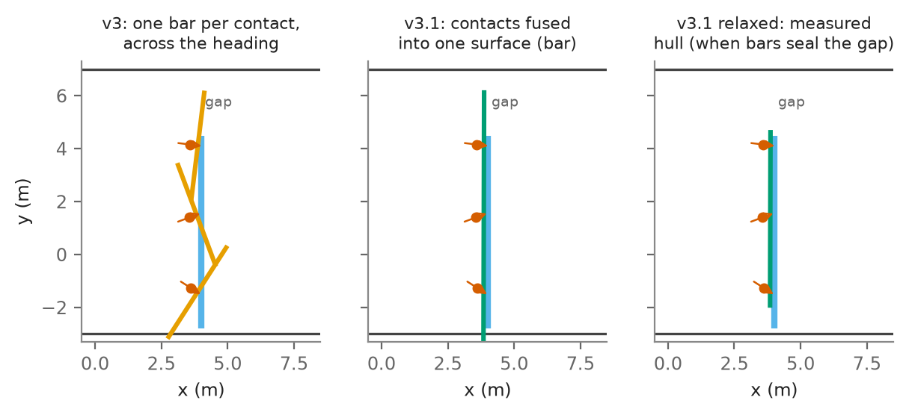{width=100%}

## 7.4 What a contact really is

The first glass flights overturned an assumption: **a contact is a bump, not a pin.**

* At about 0.3 m/s, hitting the pane threw the drone back 0.2–1.1 m and down 0.2–1.8 m.
* In the first 20 flights, 16 of 33 contacts ended the flight.
* A planner without contact detection simply bounces back into the same spot.

So the number to minimise is **contacts per mission**. We rebuilt the simulator so that a contact throws the drone back 0.5 m, and scored each mission as the chance of surviving all its contacts at 0.48 crash probability per contact.

| Planner (210 missions each, 7 scenarios) | Completed | Contacts / mission (median) | P(survive), p = 0.48 |
|---|---:|---:|---:|
| Stock A\* | 41 % | 48.4 (65) | 0.166 |
| Lazy Theta\* | 42 % | 47.6 (65) | 0.165 |
| AHPPA (after band fix) | 41 % | 47.7 (66) | 0.164 |
| AHPPA v2 | 42 % | 47.5 (65) | 0.166 |
| **v3 (contact memory)** | **100 %** | 1.74 (1) | 0.452 |
| **v3.1 (+ fusion)** | **100 %** | **1.55 (1)** | **0.460** |

: Table 13. Bump-model simulation over six unmapped-obstacle scenarios (a railing, netting, a door post, a glass door, a glass pane, two panes in series) plus a visible-railing control.

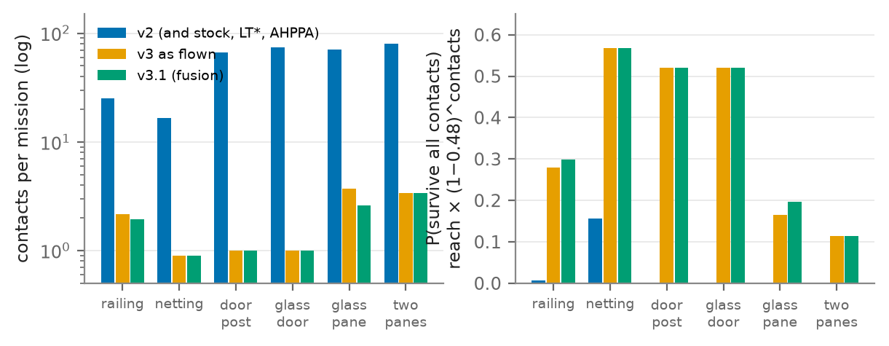{width=100%}

**Results.**

* Every map-based planner bounced off the unseen obstacle until time ran out.
* Contact memory completed every mission, with a median of one contact.
* Fusion removed another 11 % of contacts (paired Wilcoxon signed-rank test over the same missions, p = 0.0013). On the glass pane it cut contacts from 3.7 to 2.6 per mission.

# 8. Stage 5 — PX4 flights against unseen glass

## 8.1 Setup

* **World and goals:** glass_test, with goals at (8, 0) or (8, 2) at 1.8 m, behind the pane.
* **Flight ends at:** the goal; a crash (tilt ≥ 60° for 0.25 s, after which the navigator disarms); the navigator giving up; or a wall-clock time limit.
* **Batches:** four, 110 flights in all:

  | Batch | Variants | Flights |
  |---|---|---:|
  | B20 | v2, v3 | 20 |
  | B30 | v2, v3, v3.1 | 30 |
  | B40 | v3, v3.1 | 20 |
  | B50 | v3, v3.1 | 40 |

  Flights were interleaved, the order rotated every round, and the goal alternated.

**A test-harness bug.** The flight script stopped waiting and landed the drone as soon as the log said "No 2.5D path found". Memory relaxation prints exactly that, so 7 flights that relaxed their memory were cut short. They were excluded and the script was fixed. The fixed script also had a longer limit and PX4's battery failsafe switched off.

## 8.2 Results (103 valid flights)

| | v2 | v3 | v3.1 |
|---|---:|---:|---:|
| Valid flights | 20 | 46 | 37 |
| Reached the goal | 1 (5 %) | 14 (30 %) | 13 (35 %) |
| Crashed | 19 (95 %) | 32 (70 %) | 19 (51 %) |
| Gave up the goal | 0 | 0 | 5 |
| Survived the first contact | 5 (25 %) | 34 (74 %) | 33 (89 %) |
| Crashes per contact | 0.68 | 0.30 | 0.25 |
| Mean time to goal | 74 s | 104 s | 88 s |

: Table 14. PX4/Gazebo flights against the unseen pane.

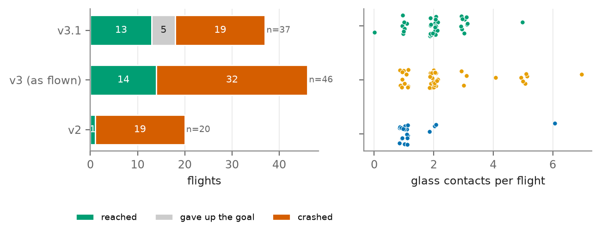{width=100%}

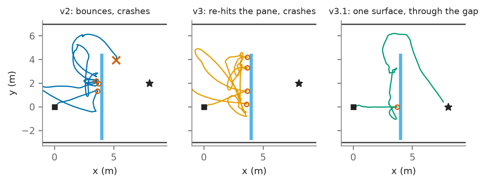{width=100%}

**What the flights show.**

* **Contact memory beats v2 clearly.** Pooling v3 and v3.1 (83 flights): 61 % crashed against 95 % (Fisher's exact test, p = 0.003), and 33 % reached the goal against 5 % (Fisher, p = 0.012).
* **The biggest effect is the reaction.** v2 keeps flying its plan after a contact and loses control. v3 and v3.1 hold, steady themselves and back off. 81 % of their flights survived the first contact, against 25 % for v2 (Fisher, p < 0.001).
* **Fusion works as designed in flight, but outcomes did not improve.** In the flights flown with the fixed script that relaxed their memory, v3.1 hit the pane 3.0 times against 4.9 for v3 (one-sided Mann-Whitney U, p = 0.002). Yet over those 60 flights v3.1 reached the goal 9 times and v3 11 times, and crashed 16 and 19 times. Neither difference is significant (Fisher, p = 0.78 and 0.60).
* **A new, unexplained failure.** In 5 v3.1 flights and no v3 flights (Fisher, p = 0.015), the navigator found no path from where the drone was hovering and dropped the goal. In all five, v3.1 was planning exactly as v3 would: no contact or one, and a single barrier is never fused. So fusion is not the cause.

# 9. Overall comparison

| | Stock A\* | AHPPA (first) | AHPPA (band fix) | v2 | v3 | v3.1 |
|---|---|---|---|---|---|---|
| Idea | one planner | switch by clearance | switch by horizontal clearance | smooth the A\* path | + remember contacts | + fuse contacts into surfaces |
| Path length (static) | 0 % | −0.6 % | −2.7 % | **−3.8 %** | = v2 | = v2 |
| Waypoints / turning | staircase | ≈ stock | −59 % / −58 % | straight segments | = v2 | = v2 |
| Planning time | 1 × | ≈ 1 × | ≈ 1.9 × | **1.02 ×** | = v2 | = v2 |
| Missions, mapped worlds | 94.8 % | — | 94.1 % | 94.8 % | = v2 (no false triggers) | = v2 |
| Missions, unmapped obstacles (sim) | 41 % | — | 41 % | 42 % | **100 %** | **100 %** |
| Contacts per mission (sim) | 48.4 | — | 47.7 | 47.5 | 1.74 | **1.55** |
| Glass flights crashed / reached | — | — | — | 95 % / 5 % | 70 % / 30 % | **51 % / 35 %** |

: Table 15. Every version on every test. "= v2": identical behaviour, because v3 and v3.1 change nothing until the drone touches something.

# 10. Conclusions

1. **Why AHPPA:** no single planner was best in our first world. A portfolio that picks a planner by local clearance was a reasonable idea, and the OPEN mode really does give shorter, far smoother paths.
2. **What the evidence said:**
   * a portfolio is only as good as its measurement — the ceiling bug made it inert indoors until fixed;
   * on static queries, switching never beats always using the best member.
3. **What AHPPA became:**
   * **v2** keeps the portfolio's benefit (nearly any-angle path length) at A\* cost;
   * **v3/v3.1** give ESCAPE the job it was always meant for: recovering from obstacles the map cannot see. That is where the large gains are — 41 % → 100 % of missions in simulation, and 95 % → 61 % crashes in PX4 flights against unseen glass.
4. **The most important lesson from flight:** a contact is a bump. *Reacting* to it (hold, steady, back off) matters as much as remembering it.

# 11. Improvements made along the way

| Problem found | Where | Fix |
|---|---|---|
| Drone mapped its own propellers | first flight | 0.5 m self-filter in the cloud merger |
| Clearance counted the ceiling | 44-layout study | ±0.3 m band (commit a7abc33) |
| Lazy Theta\* time-outs | nested pockets | 5 s member budget with A\* fallback |
| Sparse paths made the drone oscillate | flight, 17 Nov | densify to 0.1 m |
| Goals above the drone "reached" at once | flight, 17 Nov | 3D reach check and altitude hold |
| Path crossed the railing before climbing | railing crash | climb first / descend last |
| No crash response | railing crash | tilt > 60° for 0.25 s forces a disarm |
| 2D fallback planned at the wrong floor | railing crash | no fallback upstairs |
| Thin posts dropped out of the map | railing crash | 60 s occupancy memory |
| Path length cost of the slow member | baselines | v2 smoothing |
| Deadlocks from unmapped obstacles | missions, glass flights | v3 contact memory, impact detection, back-off |
| Tilted barriers let routes slip past | glass flights | v3.1 surface fusion and the hull level |
| Test script cut flights short | glass batches | script waits only for the goal or a crash |

: Table 16. Every problem found and fixed.

# 12. Limitations

* **Simulation and SITL only.** No real hardware, real glass or real depth noise yet.
* **The first contact cannot be prevented by planning.** It is the dominant failure. It needs glass perception or a contact-tolerant airframe.
* **Fusion's benefit to flight outcomes is unconfirmed.** It cuts re-contacts in flight, but too few flights relax their memory to show a better success rate.
* **The give-ups are unexplained.** Five v3.1 flights dropped their goal.
* **Timing comes from a shared, Mac-hosted VM**, so compare ratios rather than absolute times.
* **The bump-model crash probability (0.48) is an average.** In flight it was 0.68 for v2 and about 0.28 for the memory variants.
* **DENSE was barely exercised** (7 of 1,320 queries), and its distance map is 2D per layer.

# Appendix: files

| What | Where |
|---|---|
| Planner portfolio, v2, v3, v3.1 | `planners/ahppa/portfolio.py` (VM repo) |
| Navigator: impact detection, back-off, crash response, demo overlay | `planners/navigator_astar.py` |
| Self-tests | `planners/ahppa/selftest_*.py`, `planners/selftest_flight_safety.py` |
| Benchmarks | `benchmark/ahppa_multiworld.py`, `ahppa_baselines.py`, `ahppa_race.py`, `mission_sim.py`, `stuck_sim.py` |
| Worlds | `worlds/house_3room.sdf`, `indoor_10x8x3.sdf`, `house_2floor.sdf`, `glass_test.sdf` |
| Earlier reports | `AHPPA_before_after_report.pdf`, `AHPPA_detailed_report.pdf`, `AHPPA_flight_test_report.pdf`, `AHPPA_research_analysis.pdf`, `AHPPA_v3_final_report.pdf` |
| This report and its figures | `ahppa_paper/story.md`, `story_figs/`, `world_maps.py`, `story_plots.py` |

Nothing on the VM has been committed yet.
